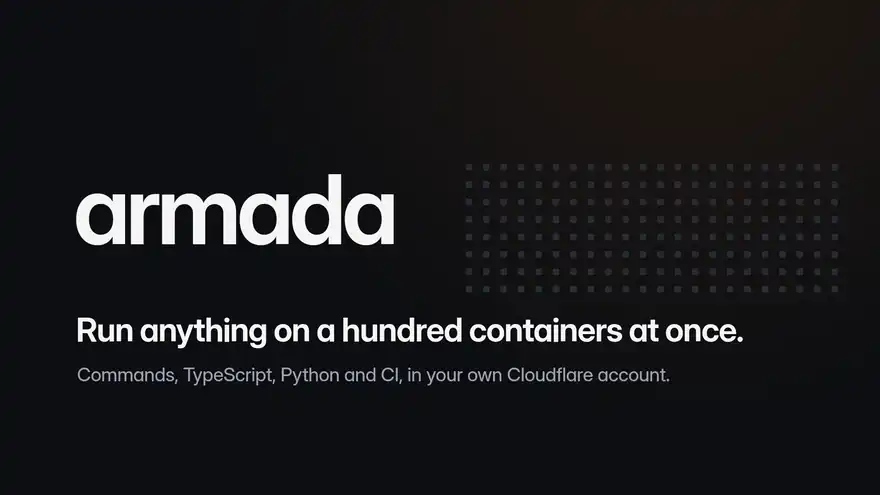
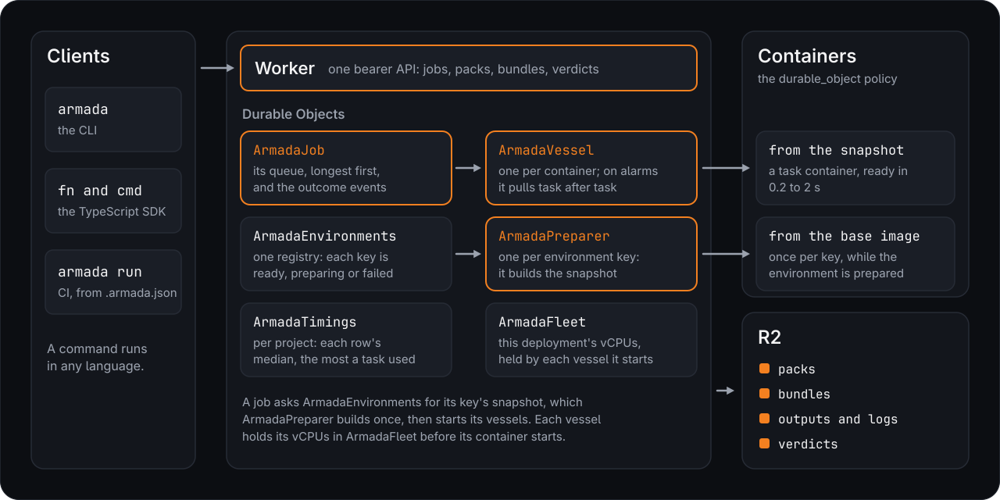
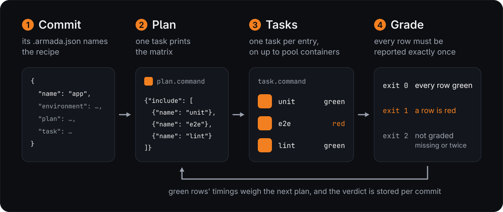

<p align="center"></p>

armada runs a command, or a TypeScript or Python function, over many inputs at once on Cloudflare Containers in your
own account. I run Kinu's and Dew's CI on it, and it can grade an RL trainer's samples.

- 100 videos re-encoded to 720p in 21 to 22 s on 100 containers, 1.3 to 1.4 times the slowest single encode. One
  container took 12 minutes for the same 100.
- A 90-row CI suite in 7 min 27 s on 13 containers, against 13 min 2 s on its 15-job GitHub Actions matrix.
- 2,048 MBPP code samples graded against their unit tests in 40 to 47 s on 210 to 255 containers.
- One `true` task came back 2.5 s after I sent it.

## Install

```sh
curl -fsSL https://raw.githubusercontent.com/AshishKumar4/armada/main/install.sh | sh
armada deploy
armada map --times=3 --json -- echo hello {item}
```

The script installs [Bun](https://bun.sh) if it's missing and puts armada in `~/.armada`. `armada deploy` logs in to
Cloudflare in your browser, or uses `CLOUDFLARE_API_TOKEN`. Containers need the Workers Paid plan.

## How it works

<p align="center"></p>

armada is a Worker, a few Durable Objects and an R2 bucket in your account, so your code and data stay there.

1. armada prepares each environment once. It starts a container from the recipe's base image, runs `setup` as root and
   `install` as the user, and snapshots the result. A changed recipe, or a changed file in `environment.key`, prepares
   a new one.
2. Containers start from the snapshot, with a fresh tmpfs on `/tmp` and `/dev/shm`. A start took a median 0.6 s, and
   its setup 0.5 s more.
3. Each container pulls task after task from the job's one queue, so none waits behind another's slow task. Items
   with a higher `weight` start first.
4. Results stream back as they land. A small output rides in the result; a large one, and every log, goes to R2.

Each task runs as the user `ci` in its own cgroup. `ARMADA_CGROUP` names it, and the task may make groups under it;
its path depends on how the job packs. armada stops anything a task leaves running. A task the platform loses runs
again, up to three attempts, so a task should be safe to run twice.

## Measured

| Workload | armada | Comparison |
|---|---|---|
| 100 generated 10-second 1080p clips, each encoded to 720p H.264 ([`examples/video-720p`](examples/video-720p)) | 21.1 s, 21.8 s and 22.3 s on 100 `small` containers (`bun bench.ts 100`) | 718.7 s in sequence on one `small` container, 7.2 s a video (`bun bench.ts 100 serial`) |
| A 90-row CI suite ([Kinu](https://github.com/AshishKumar4/kinu) at `0b74ff100`) | 7 min 27 s on 13 `medium` containers (`armada run 0b74ff100`) | 13 min 2 s on its 15-job GitHub Actions matrix ([run 37672204809](https://github.com/AshishKumar4/kinu/actions/runs/37672204809)) |
| Dew's 195-task test suite | 12.2 min on 96 `medium` containers | 31.2 min for the same tasks on a 20-job GitHub Actions matrix |
| 2,048 MBPP code samples: 8 reference or altered programs for each of 256 problems ([`examples/rlvr`](examples/rlvr)) | 39.5 s, 40.1 s and 46.5 s on 210 to 255 `micro` containers (`python3 bench.py 256 8 map 256`) | 4,790 to 5,209 s of grading in all |
| A TRL GRPO step's 16 rewards (Qwen2.5-0.5B-Instruct on one RTX 4080, two runs of four steps) | 3.2 to 4.0 s | 7 to 15 s for the whole step |
| One task from a prepared snapshot | 2.5 s from sending it to its answer (`armada map --times=1 --size=micro -- true`) | |
| 100 three-second tasks | 9.1 s and 11.4 s on 100 `micro` containers (`armada map --times=100 --pool=100 --size=micro -- sleep 3`) | 300 s of work |
| 100 cached video answers | 5.6 s and 5.7 s, with no container started (`bun bench.ts 100 cached`) | 24.0 s and 28.3 s computing them |

Over 325 green runs of Kinu's suite, the tests ended a median 2.0% after their lower bound: the longest row, or all the
rows' time split evenly over the containers, whichever is longer. Dew's tasks each took about 2.5 times as long on
armada as on GitHub's runners; armada won by running more of them at once.

## From the command line

```sh
# A flaky test, 20 times at once, in the commit's own environment
armada map --commit=HEAD --times=20 -- bun test tests/flaky.test.ts

# One task per line of urls.txt, each keeping the file it writes
armada map --items=urls.txt --output -- sh -c 'curl -sL {item} > {out}'
```

| Placeholder | Becomes |
|---|---|
| `{item}` | The item's text, or its JSON. An object item's scalar keys fill placeholders of the same name. |
| `{index}` | The item's position. |
| `{out}` | The file a task writes when `output` is set. |
| `{files}` | The directory with the job's small `files`. |
| `{artifacts}` | The directory whose files the task keeps, as a tar.gz at the task's `artifacts` route. |

An unknown placeholder is an error. An object item's numeric `weight` moves it up the queue. `map` exits 1 if a task
exits nonzero and 2 if a task could not run.

A task's environment names its run: `ARMADA_JOB_ID`, `ARMADA_INDEX`, `ARMADA_ATTEMPT`, and `ARMADA_VESSEL` for its
container. `ARMADA_STATUS_TOKEN` reads its own job's tasks and nothing else:

```sh
curl -H "Authorization: Bearer $ARMADA_STATUS_TOKEN" "$ARMADA_STATUS_URL/$ARMADA_INDEX"
```

The answer gives the job's phase, the task's state, attempt and exit code, and every run of the task that may still be
going, by container, slot and attempt. A run stays listed until its process has ended or its container is gone, even
after the job has moved on. A task that leaves a fixture behind can record these names, the URL and the token. A later
task can then check that the run is gone before it cleans up.

### Gangs

An object item's `gang` runs it on that many containers at once, for a program that spans hosts. Each rank gets
`ARMADA_RANK` and `ARMADA_WORLD`, and reaches rank `r` as host `rank<r>` (127.0.1.`r+1`) on any port it listens on.
jax.distributed's coordinator at `rank0:<port>` and gloo's collectives work over it unchanged.

```sh
echo '[{"gang": 2}]' | armada map --items=- -- sh -c 'python3 train.py --rank $ARMADA_RANK --coordinator rank0:8476'
```

The gang starts once every rank has a container. A rank the platform loses loses the whole gang, which runs again as
one task, and the outcome is the first failing rank's, else rank 0's. Containers have no inbound address, so ranks
connect through the Worker: about 5 ms a round trip and 40 to 90 MB/s a connection. That is enough for tests and
coordination, but not for bandwidth-bound training. Connect with retries, since a connection made before the other
rank listens closes at once.

## RL training

armada is the CPU side of an RL loop. Your trainer and inference server keep the GPUs, and armada runs what grades the
samples: unit tests, a compiler, a simulator, a repository's test suite. Each sample is a task with its own directory,
cgroup and time limit. Packed tasks share a container and its network, so these limits are no security boundary for
hostile code. `mode: 'fast'` runs one task at a time in each container, though a container runs later samples after
it. Cloudflare Containers have no GPUs, so training and generation stay on yours.

### Verifiable rewards with TRL

[`examples/rlvr`](examples/rlvr) grades a policy's code against MBPP's unit tests. Its reward is an armada task,
[`tasks/reward.py`](examples/rlvr/tasks/reward.py), that runs each test in a process of its own and returns the share
that passed. It catches programs that loop, crash or call `exit(0)` before their asserts run. It is no sandbox for a
policy that learns to attack its grader. TRL calls the reward once a step, and the reward grades the step's completions
as one job:

```python
from tasks.reward import unit_tests
from trl import GRPOConfig, GRPOTrainer

def unit_test_reward(completions, test_list, test_imports, **_):
    samples = [{"program": "\n".join([*imports, program(completion)]), "tests": tests}
               for completion, tests, imports in zip(completions, test_list, test_imports, strict=True)]
    return [reward(result) for result in unit_tests.stream(samples).settled()]

def reward(result):
    if result.ok:
        return result.value
    return None if result.kind in ("lost", "cancelled") else 0.0

trainer = GRPOTrainer(model="Qwen/Qwen2.5-0.5B-Instruct", reward_funcs=unit_test_reward, train_dataset=mbpp,
                      args=GRPOConfig(output_dir="grpo", num_generations=8, per_device_train_batch_size=16))
trainer.train()
```

On one RTX 4080, [`train.py`](examples/rlvr/train.py) runs four GRPO steps of 16 completions each. Over two runs, each
step's rewards came back from armada in 3.2 to 4.0 s, and each step took 7 to 15 s in all. A grader that errs or times out may have
been killed by its own program, so that sample scores 0. Only a sample the platform lost or cancelled gets `None`,
TRL's value for a reward that doesn't apply. Another trainer needs an adapter that gives each completion its tests
and returns rewards in the form that trainer expects.

[`bench.py`](examples/rlvr/bench.py) grades 8 programs for each of 256 MBPP problems: the reference solution twice,
once slowed by a second, and altered copies that answer `None`, raise, loop, exit early or are empty. The 2,048 took
39.5 s, 40.1 s and 46.5 s on 210 to 255 containers, and their tasks reported 4,790 to 5,209 s in all. Every program
that looped, raised, exited early or was empty scored 0.

### Async RL

`stream` yields each reward as it lands. An async trainer can feed it rollouts as the inference server finishes them,
and train on a prompt's group as soon as its last sample is graded instead of waiting for the slowest one in the batch:

```python
from collections import defaultdict

job = unit_tests.stream(rollouts())  # a generator: each sample as the inference server finishes it
groups = defaultdict(list)
for result in job:
    group = groups[result.item["prompt"]]
    group.append(reward(result))  # as in the TRL example above
    if len(group) == 8:
        train_on(result.item["prompt"], groups.pop(result.item["prompt"]))
```

Each rollout here holds the `program` and `tests` the reward reads, and its `prompt`, eight to a prompt. A generator
feeds an open job, which starts containers as items arrive and lets them go when none are left. Streaming the 2,048
samples above, the first group was whole at 15 to 18 s and half the groups at 28 to 50 s.

### What else fits, and what doesn't

- A reward that needs a whole repository, as SWE-style tasks do, uses an environment: armada installs the repository
  and its dependencies once on a Cloudflare base image, and each container restores the snapshot.
- A whole agent episode can run in one task, since containers reach the internet and can call your inference server.
  A `true` task took 2.5 s from sending to answer, an overhead that can outweigh a short tool call.
- Containers land on hosts of more than one CPU model, and float results can differ between them: an approximate
  instruction such as `vrsqrtps` rounds differently on each. `cpu` keeps a job on one model (see below).
- Training itself doesn't run on armada: there are no GPUs, and gang ranks connect at 40 to 90 MB/s.

## From TypeScript

This example reads each video's length and resolution, then re-encodes every video to 720p, each on its own container.
Add armada with `bun add github:AshishKumar4/armada`. `armada.config.ts` names the project and its tasks' folder:

```ts
// armada.config.ts
import { defineConfig } from 'armada';

export default defineConfig({ project: 'media', tasks: ['armada'] });
```

```ts
// armada/video.ts
import { recipe, sh, task } from 'armada';
import * as v from 'valibot';

export const media = recipe.debian().apt('ffmpeg').size('small');

// Re-encode one video to 720p H.264. sh passes ${url} and ${out} as single words, so nothing needs quoting.
export const transcode = task({
  id: 'transcode',
  recipe: media,
  output: 'bytes',
  run: (url: string, { out }) =>
    sh`ffmpeg -loglevel error -i ${url} -vf scale=-2:720 -c:v libx264 -preset veryfast -c:a aac -f mp4 ${out}`,
});

// Read a video's length and resolution with ffprobe. The output schema checks each answer when it lands.
export const probe = task({
  id: 'probe',
  recipe: media,
  output: v.object({ seconds: v.number(), width: v.number(), height: v.number() }),
  run: async (url: string) => {
    const info = JSON.parse(await sh`ffprobe -v error -select_streams v:0 -show_entries stream=width,height:format=duration -of json ${url}`.text());

    return { seconds: Number(info.format.duration), width: Number(info.streams[0].width), height: Number(info.streams[0].height) };
  },
});
```

```ts
// encode.ts
import { probe, transcode } from './armada/video';

const videos = (await Bun.file('videos.txt').text()).split('\n').filter(Boolean);

const infos = await probe.map(videos); // { seconds, width, height }[], in input order
console.log(`${videos.length} videos, ${Math.round(infos.reduce((sum, info) => sum + info.seconds, 0))} seconds in all`);

const started = Date.now();
const job = transcode.stream(videos);
let slowest = 0;

for await (const result of job) { // each file as soon as its container finishes
  slowest = Math.max(slowest, result.meta.seconds); // how long its encode ran on its container
  if (result.ok) await Bun.write(`720p/${String(result.index)}.mp4`, result.value);
  else console.error(`${result.item}: ${result.kind}`);
}
const { vessels } = await job.summary();
console.log(`encoded in ${((Date.now() - started) / 1000).toFixed(1)} s on ${vessels} containers; the slowest encode took ${slowest.toFixed(1)} s`);
```

With two 10-second 1080p test videos in `videos.txt`, `bun encode.ts` printed:

```
2 videos, 20 seconds in all
encoded in 9.1 s on 2 containers; the slowest encode took 6.4 s
```

`.map` returns values in input order and throws a `MapError` if any item fails. `.stream` yields each result as it
lands, `.run` runs one item on a container, and `.local` runs it on this machine. A failed result's `kind` is `error`,
`timeout`, `cancelled` or `lost`. Every result's `meta` has its seconds, exit code, log tail, peak memory, CPU, and its
host's CPU model and x86-64 level.

`armada push` uploads the project's tasks and drops the ones it no longer exports. A script in the project pushes on
its first run, and `armada dev` pushes on every save. A recipe is `recipe.debian()` or `recipe.from(image)`, then
`.apt()`, `.setup()`, `.install()` and `.size()`. Each container also loads the task's file, so a recipe that reads
local files goes in a function, `recipe: () => ...`, which runs only where the job starts. `sh` passes each `${}` as
one word, and `` sh.raw`...` `` doesn't escape, for a script that is itself shell.

| Task option | Meaning |
|---|---|
| `output` | A schema that checks and types each answer when it lands, or `'text'` or `'bytes'`. Without one, a body answers JSON and a command `null`. Up to 4.995 GiB, and `job.outputStream(i)` streams it. |
| `input` | A schema that checks each item before it's sent. valibot, zod and arktype all work ([Standard Schema](https://standardschema.dev)). Items and answers are plain JSON, or bytes for an answer; a `Date`, a `Map`, `any` or `unknown` is a type error. |
| `timeout` | A task's limit in seconds. |
| `retries` | Runs an item again only for the failures you name. With `{ attempts: 3, backoffSeconds: 5, exitCodes: [75], errors: ['FetchError'] }`, an item that exits 75 or throws a `FetchError` runs up to three times, 5 s and then 10 s apart. Any other failure is final. |
| `speculative` | Lets an idle container run a straggler again; the first answer is kept. |
| `hedge` | Runs this many of the heaviest items twice from the start; the first answer is kept. |
| `secrets` | Names the secrets a task reads as `context.secrets.NAME`, or a command in its environment; reading one it didn't name is a type error. `echo "$KEY" \| armada secret set NAME` stores one. Values of 4 bytes or more show as `***` in logs, and no call reads one back. `.local` reads your environment. |
| `cache` | `{ days: 7 }` keeps each green answer for a week, keyed by the task, item, recipe and pushed files. An item answered before comes back at once with `meta.cached`, and no container starts. Only for a task whose answer its item decides. |

| Job option | Meaning |
|---|---|
| `pool` | The most containers the job runs on. |
| `mode` | `efficient`, the default, packs tasks into containers by their recorded use. `fast` runs one a container. Packed tasks share the network, so tasks that bind a fixed port need `fast`. A client older than wire 9 can't name a mode, so its jobs run `fast`. |
| `slots` | More than one runs exactly that many tasks at once in each container, each in its own slot with an even share of memory, and turns packing off. A gang can't run in slots. |
| `cpu` | The CPU every container's host has, as `/proc/cpuinfo` names it: `{ vendor: 'AuthenticAMD', family: 25, model: 17 }` (`--cpu=AuthenticAMD/25/17`). A list takes any one of its CPUs (`--cpu=AuthenticAMD/25/17,AuthenticAMD/26/17`), to keep out a slow host. A container on another host is replaced before it takes a task. |
| `label`, `env`, `files`, `tmpfs` | The job's name in the dashboard, its environment, its small files (`{files}`), and the paths that get a fresh tmpfs. |

These go to `.map` and `.stream` as `map(items, { pool, slots, mode, cpu, label, env, files, tmpfs })`.

armada records each task's CPU, peak memory and disk, by its task and environment and by its item. A packed container
takes another task only while their recorded use fits its vCPUs, memory and disk, and a task it hasn't measured yet
runs alone, as does a gang's rank. Packed tasks have their own files and `/tmp` and share one memory cap, so a task
past its estimate is killed rather than the container. A task that fails beside others runs again alone before its own
retries, and its result says how the packed run ended (`aloneAfter`); if it then passes, its item always runs alone.
armada pins each task to as many CPUs as its container has vCPUs, at least one, so tools that size their threads by the
CPUs they may use, such as `nproc` and OpenMP, count those.

## From Python

The Python SDK runs the same tasks over the same wire, so a job's results read the same from either side. Install it
with `pip install "git+https://github.com/AshishKumar4/armada#subdirectory=python"`. A `[tool.armada]` table in
`pyproject.toml` names the project and its tasks' folders, `["tasks"]` by default. A folder may not be named `armada`,
the SDK's own package.

```toml
# pyproject.toml
[tool.armada]
project = "media"
tasks = ["tasks"]
```

```python
# tasks/video.py
from armada import Context, recipe, sh, task

@task(id="transcode", recipe=recipe.debian().apt("ffmpeg").size("small"), output="bytes")
def transcode(url: str, ctx: Context):
    # sh quotes each {} itself; ctx.out is the file the task answers with.
    return sh("ffmpeg -loglevel error -i {} -vf scale=-2:720 -c:v libx264 -preset veryfast -c:a aac -f mp4 {}", url, ctx.out)
```

`python -m armada push` bundles the tasks and records them, and a script pushes on its first call. `transcode.map`,
`.stream`, `.run` and `.local` work as in TypeScript, and a generator passed to `.stream` feeds an open job. A body's
return value is its answer, and `bytes` come back as `bytes`. An `output` model or function checks each answer when it
lands. [`examples/python-square`](examples/python-square) shows validators, secrets, artifacts, retries and caching,
and [`examples/rlvr`](examples/rlvr) a reward for RL.

## CI with `armada run`

<p align="center"></p>

```sh
armada run HEAD
```

`armada run` uploads the commit from your machine, so private repos and unpushed commits work. It reads the commit's
`.armada.json`, runs the plan command, and runs one task per matrix entry. armada tests itself this way:

```json
{
  "name": "armada",
  "environment": {
    "setup": "ci/setup.sh",
    "install": "ci/install.sh",
    "key": ["bun.lock", "package.json"]
  },
  "pool": 8,
  "size": "auto",
  "plan": { "command": ["echo", "{\"include\": [{\"name\": \"test\"}, {\"name\": \"typecheck\"}, {\"name\": \"relay\", \"gang\": 8}, {\"name\": \"proofs\"}, {\"name\": \"python\"}, {\"name\": \"lint\"}]}"] },
  "task": { "command": ["bun", "run", "{name}"], "verdict": false, "timeout": 600 }
}
```

Words after `armada run HEAD --` go to the plan command, to run part of the matrix. `--secrets=A,B` gives one run's
tasks those secrets. Ctrl-C cancels the job.

A run of the whole matrix stores its verdict under the commit. `armada verdict <commit>` prints it and exits 0 when
every row is green, 1 when one is red, and 2 when the commit has none, so a hook or a deploy can reuse the proof. Every
run writes its report and prints `report: <path>`, even one that can't grade every row. `armada run --json` prints its
progress on stderr and ends with one JSON object on stdout:
`{sha, planJob, job, report, graded: "pass" | "fail" | "not graded", problems, rows}`. The report has the same
`graded` value and keeps its rows under `verdicts.rows`. A row a problem names exits 2 and carries the `problem`, so it
never reads green.

Each row says the host its task ran on. A row whose task failed beside others and then passed alone grades green, as
with `mode: 'fast'`, and carries `aloneAfter` in the stored verdict, the report and `--json`. `armada run` and
`armada verdict` name each such row, and the summary line and the commit status count them.

A task can keep evidence beside its verdict: it writes files under `{artifacts}` (`ARMADA_ARTIFACTS`) and a row names
them, such as
`"artifacts": ["shots/home.png"]`. `armada run` extracts them next to the report and prints each one under a red row,
and a row naming a file its task didn't keep leaves the run ungraded. Artifacts are kept as written, so the log's
secret mask doesn't apply. `armada map --artifacts=<dir>` extracts a job's under `<dir>/<index>`. A matrix entry may
also name the `rows` its task must report; other rows leave the run ungraded.

A matrix entry may name an `environment` from `environments`: the project's `environment` with the fields it gives
replaced, in a snapshot and a task job of its own, so a container restores only what its tasks need. The pool is split
between the jobs by their entries' past timings, or their counts. The run grades every row as one, and its report lists
each job under `jobs`. One project tests two Pythons this way:

```json
{
  "environment": { "setup": "ci/setup.sh", "install": "ci/install-312.sh" },
  "environments": { "py314": { "install": "ci/install-314.sh" } }
}
```

Its plan prints `{"name": "test-312"}` for the project's environment and `{"name": "test-314", "environment": "py314"}`
for the other.

| Field | Default | Meaning |
|---|---|---|
| `name` | | The project's slug. |
| `environment.base` | `cloudflare/debian-trixie` | The base image. Only Cloudflare-managed images start. |
| `environment.setup` | | A script in the commit, run as root once per environment. |
| `environment.install` | | A script in the commit, run as `ci` in the checkout once per environment. |
| `environment.key` | `[]` | Globs over the files whose content keys the environment, such as the lockfile. |
| `environments` | `{}` | Named environments over `environment`, for the matrix entries that name one. |
| `checkout` | `/home/ci/work/<name>/<name>` | Where the commit is checked out. |
| `history` | `full` | `commit` checks out the tree without its history. |
| `env` | `{}` | Environment variables for the plan and tasks. `{workdir}` is the checkout. |
| `tmpfs` | `["/tmp", "/dev/shm"]` | Paths that get a fresh tmpfs in each container. |
| `size` | `medium` | The container size, from the table below, or `auto`. |
| `pool` | `40` | The most containers the tasks run on. The plan's `weight`s or past timings can make it fewer. |
| `target` | `300` | Seconds per task the plan aims for, passed as `{target}`. |
| `plan.command` | | Prints `{"include": [...]}`. Gets `{target}`, and `{timings}`, a file of past timings. |
| `plan.local` | `false` | Runs the plan here, on a clean checkout of the commit, instead of in a container whose start can take a minute. |
| `task.command` | | Runs one matrix entry. The entry's keys fill its placeholders. |
| `task.name` | `name` | The entry key that names a task. |
| `task.verdict` | `true` | The task writes `{"rows": [{"name", "exitCode", "seconds", "output"}]}` to `{out}`. With `false`, its exit code is its one row. |
| `task.mode` | `efficient` | As the job option. |
| `task.slots` | `1` | As the job option. |
| `task.cpu` | | As the job option, such as `{"vendor": "AuthenticAMD", "family": 25, "model": 17}`, or a list of them. |
| `task.speculative` | `false` | Lets an idle container run a straggler again. |
| `task.hedge` | `0` | Runs this many of the plan's heaviest tasks twice from the start, the first answer kept. |
| `task.timeout` | `3600` | A task's limit, in seconds. |
| `task.secrets` | `[]` | The secrets each task gets in its environment, by name. |

| Size | vCPU | Memory | Cloudflare instance type |
|---|---|---|---|
| `micro` | 1/2 | 4 GiB | `standard-1` |
| `mini` | 1 | 6 GiB | `standard-2` |
| `small` | 2 | 8 GiB | `standard-3` |
| `medium` | 4 | 12 GiB | `standard-4` |

With `"size": "auto"`, each run takes the smallest size that the last five runs' tasks fill to three quarters at most,
in peak memory and average busy cores. A new size prepares its own environment once.

### CI on push, through a GitHub webhook

```sh
armada webhook add armada --repo=owner/name --pull-requests
```

Each push to the repo's branches, and each pull request from the same repository, then starts that commit's whole
`armada run` on the deployment. With no `--branches`, only the default branch builds. The run stores its verdict as a
local run does and posts a GitHub commit status, such as "88 of 90 rows green", that links to the dashboard's CI page.

armada checks GitHub's `X-Hub-Signature-256` on each delivery and skips a delivery or a commit it has seen. It never
builds a pull request from a fork, because that code must not get the deployment's secrets. The run uses armada at the
deployment's own commit, so deploy from a pushed commit.

`armada webhook add` creates or updates the hook through `gh` when you're signed in, and otherwise prints the settings
to add by hand. `armada webhook list` and `armada webhook remove <project>` manage them.

## Dashboard

`armada dashboard` opens the deployment's dashboard signed in, and the token never leaves your browser. `--serve=<port>`
serves it from your machine instead, which signs each request itself. It shows the fleet, recent jobs, each job's tasks
and container timeline, each task's item, output, log and artifacts, the environments, and each project's CI
verdicts. A search, and a pick of a repository job's project, narrow the jobs. `--all` also signs in to every other
deployment you have a connection to that answers. Its fleet page shows them all in one list, and a pick in the top bar
opens one deployment's own pages. Each bearer stays in that one browser.

## Deploying

`armada deploy --name=<name>` deploys another armada on the same account and prints the file that `--connection=<file>`
takes, to point any command at it. `--vcpus=N` caps its fleet.

Every container app in an account shares its vCPUs, 1,500 by default. A fleet can borrow what the rest of the account
leaves idle past its cap: give the deploy a token that reads the account's containers (Account > Containers: Read) as
`ARMADA_ACCOUNT_TOKEN`. The fleet then reads the account every 30 s and lends half of what is idle, keeping a tenth of
the account free for other apps. A container on borrowed vCPUs asks before each new task, and the newest loans finish
their tasks and end once other apps need the room. The connection file keeps the token for later deploys, and a
deploy with an empty `ARMADA_ACCOUNT_TOKEN` stops the borrowing.

A deploy over a running armada keeps its jobs running. It drains them first with `--drain`, or when the new version
can't take them over: when it would refuse a client the deployed one serves, or when its Durable Objects call each
other differently or store other shapes. The deployed objects keep running their code for minutes after a deploy, so
such a version refuses new jobs until its deployment-wide objects run its own code.

The Worker deletes environment snapshots it no longer needs, since an account's snapshots are limited. It keeps the
ones open jobs use, the 3 most recently used others (`--keep=N` changes the count), and any used in the last hour. It
prunes when deployed, after each new environment and every hour. `armada prune` prunes now, and `--keep=0` keeps only
what open jobs use. A client and a Worker too far apart in version refuse each other, and say which one to update.

## Commands

```
armada deploy [--account=<id>] [--name=<name>] [--vcpus=N] [--drain] [--keep=N]
armada map [--env=<recipe.json> | --commit=<rev>] (--times=N | --items=<file|->) [--size=<size>] [--pool=N] [--slots=N] [--mode=efficient|fast] [--cpu=<vendor/family/model>[,...]] [--timeout=S] [--output] [--artifacts=<dir>] [--speculative] [--hedge=N] [--secrets=<A,B>] [--json] -- <command>
armada run <commit|worktree> [--label=<text>] [--secrets=<A,B>] [--json] [-- <plan args>]
armada verdict <commit|worktree> [--json]
armada push
armada dev
armada status <job-id>
armada dashboard [--serve=<port>] [--all]
armada secret set <NAME> | list | delete <NAME>
armada webhook add <project> --repo=<owner/name> [--branches=a,b] [--pull-requests] [--token-secret=NAME]
armada webhook list
armada webhook remove <project>
armada prune [--keep=N]
```

`armada --help` describes every option.
